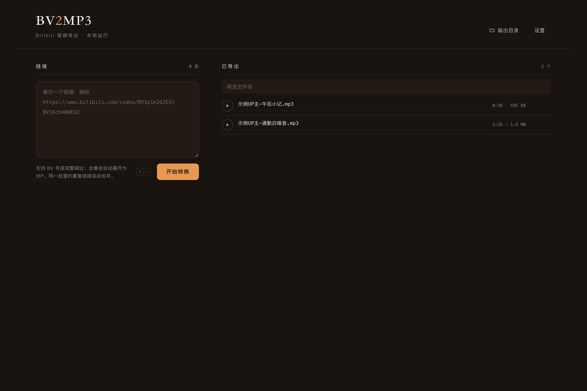

# BV2MP3

> 把 Bilibili 视频批量转成本地 MP3 的单机工具。粘贴链接，后台下载音轨并用 ffmpeg 转码，成品直接落到本地文件夹。全程本地运行，不登录、不上传。

[](LICENSE)
[](https://nodejs.org)



<p align="center"><sub>界面预览（暗色模式，示例数据） · <a href="docs/screenshots/light.png">查看浅色模式</a></sub></p>

名字里的 `2` 就是中间那一步：视频 → 音频。

## 功能

- **批量转换**：一次粘贴多条链接，自动排队执行。
- **链接识别**：支持 BV 号与完整网址，自动去重。
- **合集展开**：多 P 视频按分 P 拆成独立文件。
- **实时进度**：SSE 推送，失败精确到具体链接。
- **内置试听**：导出后可直接播放、在 Finder 中显示、删除。
- **本地优先**：无账号、无云服务、不收集任何数据。

## 快速开始

### 前置条件

- [Node.js](https://nodejs.org) 20 或更高版本
- [ffmpeg](https://ffmpeg.org) 已加入 `PATH`（macOS：`brew install ffmpeg`）

### macOS：双击启动

首次使用前，在项目目录执行一次（Git 不一定会保留可执行权限）：

```bash
chmod +x start.command
```

然后双击 `start.command`。服务启动后会自动打开浏览器（默认 <http://127.0.0.1:7788>），地址同时复制到剪贴板。

若被系统拦截，右键 `start.command` → 打开。

### 终端启动（macOS / Linux / Windows）

```bash
git clone https://github.com/hindyhong/bv2mp3-studio.git
cd bv2mp3-studio
npm install
npm start          # 启动并打开浏览器
```

也可以只启动服务、不打开浏览器：

```bash
node server.mjs
```

换端口：`PORT=3000 node server.mjs`。端口被占用时会自动顺延。

## 使用

1. 左侧粘贴链接，每行一个；BV 号和完整网址都认。
2. 按「开始转换」（或 `⌘ + Enter` / `Ctrl + Enter`）。
3. 右侧出现的 MP3 可以直接试听、在 Finder 中显示、删除。

- 同一批里的重复链接自动合并。
- 多批次会排队执行；每批内部按「并发数」并行下载与转码。
- 文件名固定为 `UP主-标题.mp3`，与 B 站标题一致。

## 配置

点右上角「设置」：

- **输出目录**：默认 `output/`，可改成任意本地路径。
- **并发数**：默认 10，范围 1–16。

配置保存在 `data/config.json`，首次启动自动生成。

## 工作原理

```
浏览器
  │  粘贴链接 / SSE 订阅进度
  ▼
server.mjs ── 静态页面 · 任务队列 · 音频流
  │  spawn（JSON 通过 stdin/stdout 传递）
  ▼
worker.mjs ── 解析页面 → 下载音轨 → ffmpeg 转 MP3
  │
  ▼
output/UP主-标题.mp3
```

转换引擎复用 [bv2mp3](https://github.com/wxsms/bilibili-video2mp3) 的抓取与下载模块。

## 项目结构

```
bv2mp3-studio/
├── server.mjs              本地服务：静态页、任务队列、SSE 进度、音频流
├── worker.mjs              转换进程：抓页面 → 取音轨 → ffmpeg 转 MP3
├── public/                 前端
│   ├── index.html
│   ├── style.css
│   └── app.js
├── docs/
│   ├── PRODUCT.md          产品定位与设计原则
│   ├── DESIGN.md           界面设计规范
│   └── screenshots/        界面截图
├── data/config.json        配置（首次启动自动生成，不纳入版本控制）
├── output/                 默认输出目录（不纳入版本控制）
├── start.command           macOS 双击启动
├── LICENSE
└── package.json
```

## 已知限制

- 以匿名身份访问 B 站。需要登录、大会员或受地区限制的视频会失败，失败条目会在界面上标出。
- 只取 B 站默认档的 DASH 音轨，源音质为普通档。
- 「在 Finder 中显示」为 macOS 专属；其他系统上服务与转换功能正常，仅该按钮无效。
- 按「个人本地使用」设计，未做公网部署所需的多用户隔离、限流与鉴权。

## 常见问题

**双击 `start.command` 没有反应？**

在终端执行一次 `chmod +x start.command`，或右键选择「打开」。

**提示未检测到 ffmpeg？**

确认 `ffmpeg -version` 能在终端运行。双击启动时 `PATH` 可能较短，`start.command` 已补充 Homebrew 的常见安装路径。

**某些视频转换失败？**

多为需要登录、会员或地区限制的内容。把链接单独重试；仍失败则说明当前匿名访问拿不到音轨。

**端口被占用？**

服务会自动尝试后续端口。也可显式指定：`PORT=3000 node server.mjs`。

## 免责声明

本项目仅用于个人学习、技术研究与离线备份，与哔哩哔哩（Bilibili）官方无关。

请遵守 B 站服务条款与所在地区的著作权法规，不要将下载内容用于商业用途或二次传播。因使用本项目产生的任何后果由使用者自行承担。

## 参与贡献

欢迎提交 Issue 与 Pull Request。请保持改动聚焦，遵循现有代码风格；涉及新依赖时请先说明必要性。

## 许可

本项目代码以 [MIT License](LICENSE) 发布。

转换引擎 [bv2mp3](https://github.com/wxsms/bilibili-video2mp3) 由 [wxsms](https://github.com/wxsms) 开发，同样以 MIT License 发布；音视频处理依赖 [ffmpeg](https://ffmpeg.org)。
